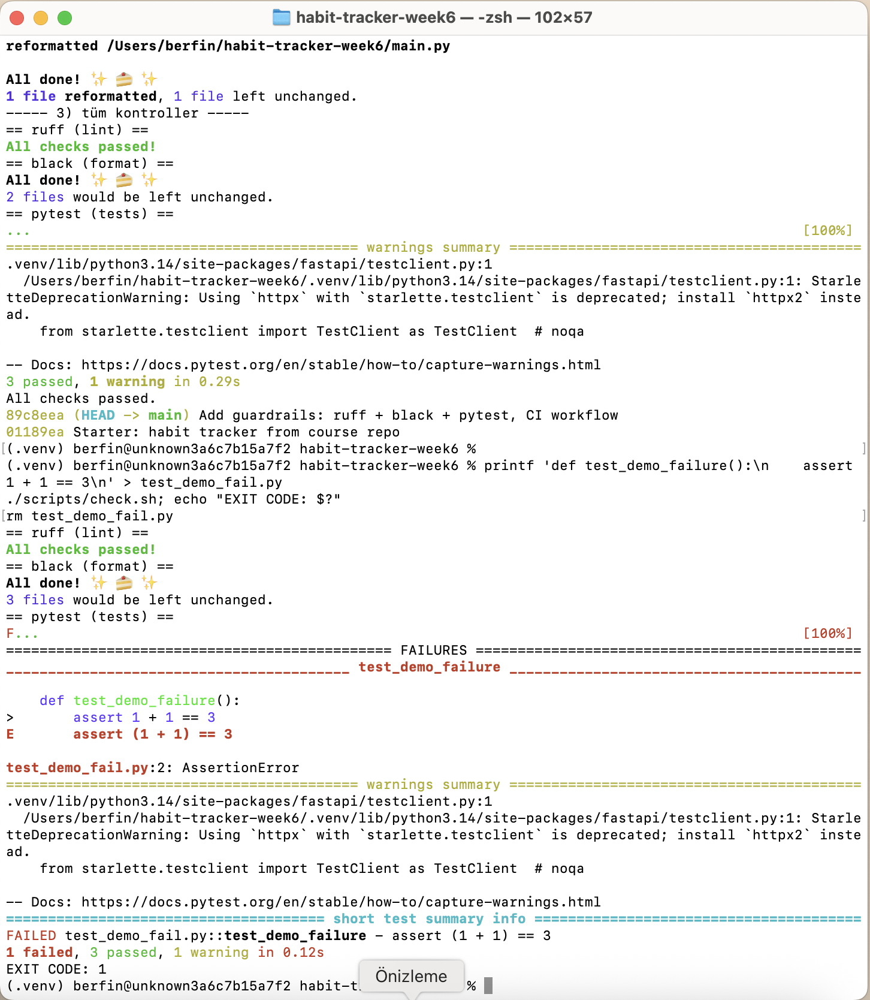

# Week 6 Writeup — AI Code Review & Testing: The Habit Tracker

**Agent used to implement:** Antigravity CLI (`agy`), model Gemini 3.8 Flash (High) — one one-shot prompt per task.
**AI reviewer:** [CodeRabbit](https://coderabbit.ai) (free plan, public repo, default "Chill" profile).
**Repository:** https://github.com/berfinaksoyy/habit-tracker-week6

| PR | Task | Commits |
|---|---|---|
| [#1 Add habit streak endpoint](https://github.com/berfinaksoyy/habit-tracker-week6/pull/1) | 1 — Streak | agent: [`7f91601`](https://github.com/berfinaksoyy/habit-tracker-week6/commit/7f91601) · my review: [`86767b9`](https://github.com/berfinaksoyy/habit-tracker-week6/commit/86767b9) · after CodeRabbit: [`1565ea1`](https://github.com/berfinaksoyy/habit-tracker-week6/commit/1565ea1) |
| [#2 Validate habit names and check-in days](https://github.com/berfinaksoyy/habit-tracker-week6/pull/2) | 2 — Validation | agent: [`cb4d00a`](https://github.com/berfinaksoyy/habit-tracker-week6/commit/cb4d00a) · my review: [`d4d69f0`](https://github.com/berfinaksoyy/habit-tracker-week6/commit/d4d69f0) · ruff fix: [`fab655f`](https://github.com/berfinaksoyy/habit-tracker-week6/commit/fab655f) |

Each PR keeps the agent's one-shot output as its own commit, so the diff of the next commit shows exactly what my review changed.

---

## 1. Guardrails (Part I)

Added in [`89c8eea`](https://github.com/berfinaksoyy/habit-tracker-week6/commit/89c8eea): `pyproject.toml` (black + ruff config, 100-char lines), `requirements-dev.txt`, `scripts/check.sh`, and `.github/workflows/ci.yml`.

| Command | What it catches |
|---|---|
| `ruff check .` | unused imports/variables, undefined names, import order, common bug patterns (bugbear), outdated syntax |
| `black --check .` | code that is not formatted the agreed way |
| `pytest` | broken behaviour — any failing or erroring test exits non-zero |
| `./scripts/check.sh` | runs all three in order and stops at the first failure (`set -euo pipefail`) |

CI runs the same three steps on every push to `main` and every PR; both PRs show a green `CI/check`.

**What the guardrails actually caught in this assignment**
- **Unmodified starter:** `black --check` failed on the course's own `main.py` (1 file would be reformatted) — fixed by running `black .` in the guardrails commit.
- **My own review commit on PR #2:** `ruff` reported `I001 Import block is un-sorted` in `test_main.py` (I had put `import pytest` above `from datetime …`). Fixed with `ruff check --fix` in [`fab655f`](https://github.com/berfinaksoyy/habit-tracker-week6/commit/fab655f). The human edit, not the agent, broke the lint.
- **A failing test fails the build:** a temporary `assert 1 + 1 == 3` test made `./scripts/check.sh` print `1 failed, 3 passed` and exit with code **1**; the test was then deleted.

---

## 2. PR #1 — Streak

**One-shot prompt:** *"Implement task 1 (Streak) from docs/TASKS.md: add GET /habits/{id}/streak that returns the current run of consecutive days, up to and including today, that have a check-in. Add tests in test_main.py for it. Make ./scripts/check.sh pass. Do not commit."* ([screenshot](docs/evidence/streak-agent-oneshot.png))

The agent added `calculate_streak(checkin_dates, today=None)`, the endpoint (404 for an unknown habit) and 8 API tests. All checks passed.

### My review vs. CodeRabbit

| # | Issue | Found by me | Found by CodeRabbit | Outcome |
|---|---|---|---|---|
| 1 | **Spec ambiguity:** the task says "up to and including today", but if today has no check-in the code still counts the run that ended yesterday (`test_streak_yesterday_not_today` expects 2). | ✅ | ❌ | Kept the behaviour (the day is not over) and documented the rule in a docstring and as a PR tradeoff. |
| 2 | **Clock-dependent tests:** every agent test used `date.today()`, so a run crossing midnight could fail. | ✅ | ✅ (reported only after my fix — see #3) | I added fixed-date tests for `calculate_streak` (incl. a month boundary). |
| 3 | **…but my fix was incomplete:** the API tests and the endpoint still read the real clock. CodeRabbit gave a concrete case: checkins stored on 9–10 March at 23:59, GET after midnight → endpoint returns 0 instead of 2. | ❌ | ✅ (Minor, inline on `test_main.py:66`) | Agreed and replied in the thread; froze `main.date.today()` to 2026-03-10 with an autouse fixture in [`1565ea1`](https://github.com/berfinaksoyy/habit-tracker-week6/commit/1565ea1). |
| 4 | **Silent skip:** a malformed stored `day` is skipped with `except …: continue` and no test covers it. | ✅ | ❌ | Added a test that inserts `"hello"` directly into the DB; blocking bad input belongs to PR #2. |

**Where the AI was better:** it noticed that my fix for #2 only protected the helper function, not the endpoint, and explained the exact failing scenario. I had judged the problem "solved" too early.
**Where the AI was worse:** one comment in total. It did not question the "yesterday still counts" rule (a product decision against the literal task) or the silent skip of bad data.

---

## 3. PR #2 — Validation

**One-shot prompt:** *"Implement task 2 (Validation) from docs/TASKS.md: reject empty habit names and malformed day values on POST /habits and POST /habits/{id}/checkin with a 422 or 400 and a clear error message. Add tests in test_main.py for it. Make ./scripts/check.sh pass. Do not commit."* ([screenshot](docs/evidence/validation-agent-oneshot.png))

The agent added Pydantic `field_validator`s and 7 tests (some parametrized). All checks passed.

### My review vs. CodeRabbit

| # | Issue in the agent's version | Found by me | Found by CodeRabbit | Outcome |
|---|---|---|---|---|
| 1 | **Misleading message:** `2026-02-30` has the right format but does not exist, yet the message was "Invalid date format". | ✅ | ❌ | Split into `Day must use the format YYYY-MM-DD` and `'2026-02-30' is not a real calendar date`. |
| 2 | **Unclear message:** `ValueError` made the client see `Value error, Habit name cannot be empty`. | ✅ | ❌ | Switched to `PydanticCustomError`; new tests check the exact `detail[0].msg`. |
| 3 | **Missing length limit:** a 5000-character name was accepted. | ✅ | ❌ | 100-character limit, tested at 100 vs 101. |
| 4 | **Future days accepted:** a check-in for `2099-01-01` was allowed. | ✅ | ❌ | Rejected days after today, tested today vs tomorrow. |
| 5 | **Weak assertions:** agent tests only check that a word appears somewhere in `r.text`. | ✅ (noted, kept) | ❌ | Left as is; added stricter tests next to them. |
| 6 | **Security scope:** inputs still reach the same columns through parameterized SQL; no new routes or sinks. | — | ✅ (walkthrough) | Useful confirmation; no change needed. |

CodeRabbit returned **"No actionable comments"**, a walkthrough table and a "Minimal" merge/security risk rating.

**Important caveat for a fair comparison:** CodeRabbit reviewed the PR's final state (base → `fab655f`), i.e. *after* my review fixes, so issues 1–4 were already gone when it looked. It still did not mention the remaining weak `r.text` assertions (#5) or the tradeoffs I listed in the PR (server-local "today", and 422 before 404 for a bad day on an unknown habit).
**Where the AI was better:** a clear, structured summary of what changed and a security "blast radius" check I would not have written myself.
**Where the AI was worse:** nothing actionable; it accepted the tests without judging their strength.

---

## 4. What I learned
In this assignment I learned that automated guardrails and AI review do not replace each other, because they catch different things. What surprised me most was how little CodeRabbit found: on PR #2 it did not mention any of the four issues I found and said there was nothing to fix. That is why I trust AI review only a little, and I need to check whether a suggestion is correct before I apply it. From now on I will always review the code myself as well, because only a person asks questions like "what does the task actually want?"
